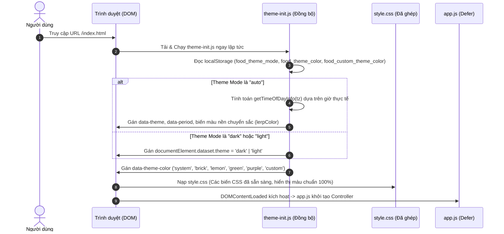
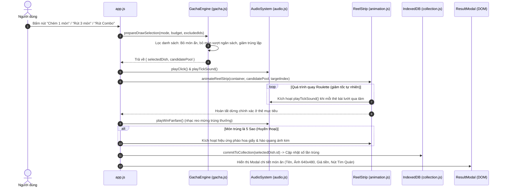
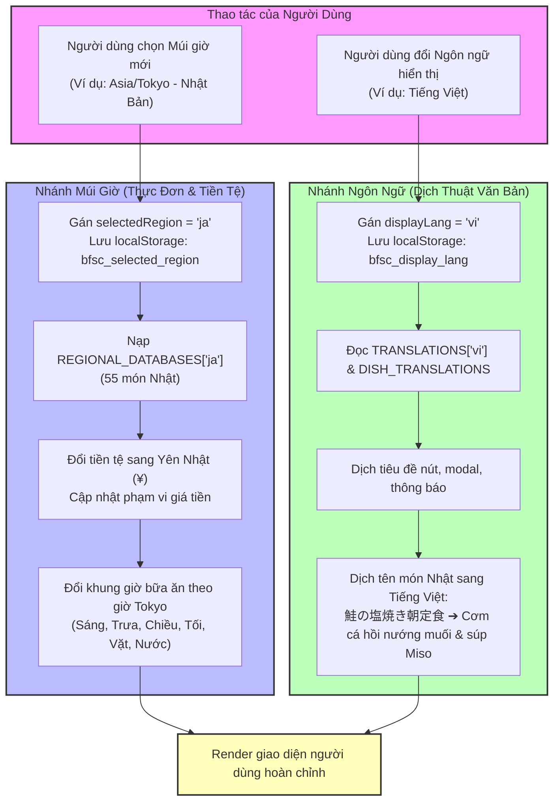

# 🤖 AI System Reference: Kiến Trúc & Hướng Dẫn Toàn Diện Cho AI Coding Agents

> **Tài liệu đặc tả kỹ thuật cấp cao dành cho AI Coding Assistants (Antigravity, Claude, Copilot, ChatGPT) nhằm đọc, phân tích, định hướng và can thiệp mã nguồn chính xác 100%, không bị ảo giác (hallucination) hay phá vỡ kiến trúc dự án.**

---

## 📌 1. Triết Lý & Mô Hình Tư Duy Cốt Lõi (Mental Model for AI)

Dự án này tuân thủ triết lý **Pure Web Fundamentals & Zero-Runtime-Dependency**:

1. **Không sử dụng bất kỳ Framework hoặc Bundler hiện đại nào lúc runtime**:
   - ❌ **KHÔNG** React, Vue, Angular, Svelte.
   - ❌ **KHÔNG** Webpack, Vite, Rollup, Parcel, Babel, Tailwind, Sass, PostCSS.
   - ✅ **Mã nguồn chạy trực tiếp trên trình duyệt**: JavaScript ES6+ thuần, CSS3 mô-đun, HTML5 ngữ nghĩa.
2. **Mô hình Xuất Bản Độc Lập qua Thư Mục Tĩnh (`public/`)**:
   - Mã nguồn gốc nằm trong `src/` và `backend/`.
   - Thư mục `public/` là **kết quả biên dịch tĩnh (Build Artifact)** duy nhất được triển khai lên máy chủ web hoặc dịch vụ CDN.
   - ⚠️ **LUẬT THÉP**: **KHÔNG BAO GIỜ sửa trực tiếp các tệp trong `public/`**. Mọi chỉnh sửa tại `public/` sẽ bị xóa sạch khi chạy `build_public.py`. Luôn sửa trong `src/`, `scripts/` hoặc `backend/`, sau đó kích hoạt build.
3. **Cơ chế Allowlist Nghiêm Ngặt (`scripts/public_files.py`)**:
   - Máy chủ Python (`backend/server.py`) và quy trình build (`scripts/build_public.py`) kiểm tra nghiêm ngặt danh sách `PUBLIC_FILES`.
   - Nếu bạn thêm một tệp mới (ảnh, font, script, css) vào `src/` nhưng **chưa đăng ký vào `scripts/public_files.py`**, máy chủ sẽ trả về HTTP 404 và quy trình build sẽ từ chối xuất bản.
4. **Kiến trúc PWA 100% Offline**:
   - `src/sw.js` lưu trữ bộ nhớ đệm toàn bộ 333+ hình ảnh món ăn WebP và toàn bộ tài nguyên tĩnh.
   - Người dùng có thể quay Gacha, xem thực đơn, duyệt bộ sưu tập ngay cả khi ngắt kết nối Internet hoàn toàn.
5. **Độc lập tuyệt đối giữa Múi Giờ và Ngôn Ngữ Hiển Thị**:
   - **Múi giờ (`selectedRegion`)**: Quyết định cơ sở dữ liệu ẩm thực (Việt Nam, Nhật, Hàn, Trung, Âu Mỹ), bữa ăn theo giờ địa phương và đơn vị tiền tệ (`₫`, `¥`, `₩`, `$`).
   - **Ngôn ngữ hiển thị (`displayLang`)**: Quyết định ngôn ngữ của các chuỗi UI và tên món ăn qua từ điển dịch `TRANSLATIONS` & `DISH_TRANSLATIONS`. Đổi ngôn ngữ **không bao giờ** làm thay đổi thực đơn hay giá tiền.

---

## 🗺️ 2. Bảng Danh Mục Tệp & Mức Độ Quan Trọng (File Criticality Inventory)

Dự án phân cấp các tệp thành **4 mức độ quan trọng (Tiers)**:
- 🔴 **Tier 1 (Core Critical)**: Hệ thống sống còn, nếu hỏng ứng dụng sẽ sập ngay lập tức hoặc không thể khởi động.
- 🟡 **Tier 2 (Feature Subsystems)**: Các động cơ chức năng quan trọng (Gacha, Theme, Âm thanh, Bộ sưu tập).
- 🟢 **Tier 3 (Integrations & UI Helpers)**: Tiện ích mở rộng, liên kết bản đồ, toast thông báo.
- ⚪ **Tier 4 (Build, Tooling & Tests)**: Kịch bản phát hành, công cụ dọn dẹp, bài kiểm thử.

| Đường dẫn tệp | Cấp độ | Trách nhiệm chính | Phụ thuộc vào (Imports/Calls) | Được gọi bởi (Depended On By) |
| :--- | :---: | :--- | :--- | :--- |
| `src/index.html` | 🔴 **Tier 1** | Cấu trúc DOM chính, điểm nạp tài nguyên, thứ tự nạp thẻ script | Tất cả các script trong `src/js/` và `style.css` | Người dùng, Web Server |
| `src/js/app.js` | 🔴 **Tier 1** | Controller chính của ứng dụng, kết nối DOM, xử lý sự kiện, dịch thuật UI | `gacha.js`, `data.js`, `controls.js`, `audio.js`, `animation.js`, `ui.js`, `nearby.js` | `src/index.html` |
| `src/js/data.js` | 🔴 **Tier 1** | CSDL 333 món ăn 5 quốc gia (`FOOD_DATABASE`, `REGIONAL_DATABASES`), từ điển `DISH_TRANSLATIONS` | Độc lập | `app.js`, `gacha.js`, `tests/` |
| `src/theme-init.js` | 🔴 **Tier 1** | Khởi tạo giao diện đồng bộ trước khi CSS render để chống chớp giao diện (FOUC) | LocalStorage, Intl API | `src/index.html` (thẻ script đồng bộ ở `<head>`) |
| `src/js/gacha.js` | 🔴 **Tier 1** | Lớp `GachaEngine`: Thuật toán quay thưởng, lọc ngân sách, giảm lặp, tính xác suất | `data.js`, `dish-preferences.js`, `collection.js` | `app.js`, `tests/` |
| `scripts/public_files.py` | 🔴 **Tier 1** | Allowlist các tệp được phép xuất bản ra `public/` và phục vụ qua HTTP | Độc lập | `scripts/build_public.py`, `backend/server.py`, `tests/` |
| `scripts/build_public.py` | 🔴 **Tier 1** | Động cơ build tĩnh: ghép CSS, copy asset, dọn dẹp file thừa | `scripts/public_files.py` | `server.py`, `package.json`, CI/CD |
| `backend/server.py` | 🔴 **Tier 1** | Máy chủ HTTP Python cục bộ, thực thi CSP, chống path traversal, phát hiện LAN IP | `scripts/public_files.py`, `scripts/build_public.py`, `backend/places_service.py` | `server.py`, `run_server.py` |
| `src/styles/themes.css` | 🟡 **Tier 2** | Định nghĩa biến CSS cho Dark/Light mode, bảng màu hệ thống, auto theme theo thời gian | CSS Variables | Ghép vào `/style.css` qua `build_public.py` |
| `src/styles/base.css` | 🟡 **Tier 2** | CSS Reset, font chữ, bố cục khung nhìn máy tính và tablet | Biến màu từ `themes.css` | Ghép vào `/style.css` qua `build_public.py` |
| `src/styles/mobile.css` | 🟡 **Tier 2** | Tối ưu hóa hiển thị cho màn hình điện thoại di động | `base.css` | Ghép vào `/style.css` qua `build_public.py` |
| `src/js/controls.js` | 🟡 **Tier 2** | Dropdown tùy biến chuẩn WAI-ARIA, bàn phím điều hướng, modal chọn màu tùy biến | DOM API | `app.js` |
| `src/js/animation.js` | 🟡 **Tier 2** | Trục quay ngang Roulette CS:GO, đường cong giảm tốc `cubic-bezier`, hiệu ứng pháo hoa | `audio.js`, DOM API | `app.js` |
| `src/js/audio.js` | 🟡 **Tier 2** | Bộ tạo âm thanh sống động bằng Web Audio API thuần (tiếng gõ tick, nhạc reo thắng) | Web Audio API | `app.js`, `animation.js` |
| `src/js/collection.js` | 🟡 **Tier 2** | Quản lý sổ tay món ăn trong IndexedDB (`food_collection_db`), tương thích ngược | IndexedDB API | `gacha.js`, `app.js` |
| `src/js/dish-preferences.js` | 🟡 **Tier 2** | Quản lý danh sách món ẩn (blacklist), món yêu thích, món ăn gần đây | LocalStorage | `gacha.js`, `app.js` |
| `src/sw.js` | 🟡 **Tier 2** | Service Worker quản lý bộ nhớ đệm CacheStorage, hỗ trợ PWA offline 100% | Cache API | Trình duyệt đăng ký từ `ui.js` |
| `src/js/nearby.js` | 🟢 **Tier 3** | Tạo liên kết Google Maps tìm quán ăn xung quanh với từ khóa bản địa hóa | Geolocation API | `app.js` |
| `src/js/ui.js` | 🟢 **Tier 3** | Hiển thị thông báo Toast, điều khiển Modal, chia sẻ Web Share API, cài đặt PWA | DOM API | `app.js` |
| `src/js/experience.js` | 🟢 **Tier 3** | Haptic feedback (Rung thiết bị di động), kiểm tra giảm hiệu ứng chuyển động | Navigator.vibrate | `app.js`, `animation.js` |
| `api/places.py` | 🟢 **Tier 3** | Serverless endpoint Vercel xác nhận chế độ Google Maps miễn phí | `backend/places_service.py` | Vercel Deployment |
| `tests/test_server.py` | ⚪ **Tier 4** | Kiểm thử an ninh máy chủ, kiểm thử bảo mật CSP, kiểm thử routing | Python unittest | CI/CD |
| `tests/test_places_budget.py` | ⚪ **Tier 4** | Kiểm thử tính toán ngân sách và ràng buộc giá tiền | Python unittest | CI/CD |

---

## 🔄 3. Sơ Đồ Kiến Trúc & Luồng Dữ Liệu (Execution Flowcharts)

### Sơ đồ 1: Khởi Động Ứng Dụng & Thiết Lập Giao Diện (App Boot & Theme Initialization)

Script `theme-init.js` chạy đồng bộ tại thẻ `<head>` **trước khi bất kỳ CSS nào được render** nhằm đảm bảo không bao giờ xảy ra hiện tượng chớp nháy giao diện (Zero Flash of Unstyled Content / FOUC):



---

### Sơ đồ 2: Vòng Đời Của Một Lượt Quay Gacha Roulette (Gacha Roll Lifecycle)



---

### Sơ đồ 3: Cơ Chế Tách Biệt Độc Lập Giữa Múi Giờ & Ngôn Ngữ Hiển Thị



---

## 📦 4. Cấu Trúc Dữ Liệu Chuẩn (Data Schemas & Type Contracts)

### 4.1. Hợp đồng dữ liệu Món Ăn (`Dish` Object)

Mỗi món ăn trong `FOOD_DATABASE` hoặc `REGIONAL_DATABASES` đều tuân thủ cấu trúc nghiêm ngặt:

```typescript
interface Dish {
  id: string;               // Mã định danh duy nhất (vd: 'sang_5_2', 'ja_m_2', 'ko_l_1')
  name: string;             // Tên gốc bản địa (vd: '鮭の塩焼き朝定食', '전통 보쌈', 'Bún bò Huế')
  rarity: 3 | 4 | 5;        // Độ hiếm (3: Đồng/Phổ biến, 4: Bạc/Đặc sắc, 5: Vàng/Huyền thoại)
  type: string;             // Thể loại (vd: 'Cơm', 'Mì/Phở', 'Bánh', 'Lẩu', 'Nước ngọt')
  image: string;            // Đường dẫn ảnh WebP tương đối từ gốc public (vd: 'images/regional/ja/ja_m_2.webp')
  desc: string;             // Mô tả hương vị & nguyên liệu chi tiết (tiếng Việt chuẩn)
  calories: number;         // Lượng calo ước tính (Kcal)
  tags: string[];           // Danh sách nhãn phục vụ tìm kiếm & phân loại
  price: number;            // Giá tham khảo chuẩn (đơn vị tiền bản địa: VNĐ, JPY, KRW, CNY, USD)
  priceRange: [number, number]; // [Giá tối thiểu, Giá tối đa]
  priceMin: number;         // = priceRange[0]
  priceMax: number;         // = priceRange[1]
}
```

### 4.2. Hợp đồng dữ liệu Khung Bữa Ăn (`MealSession`)

```typescript
interface MealSession {
  id: 'morning' | 'lunch' | 'afternoon' | 'dinner' | 'snacks' | 'drinks';
  name: string;             // Tên hiển thị của bữa ăn
  title: string;            // Tiêu đề câu hỏi gợi ý
  bannerName: string;       // Tên tiêu đề trên banner chính
  subtitle: string;         // Phụ đề mô tả hương vị buổi ăn
  featured5Star: string;    // Tên món 5 sao tiêu biểu của bữa
  bannerImage: string;      // Đường dẫn ảnh banner đại diện
  theme: string;            // Chủ đề thời gian
  dishes: Dish[];           // Mảng danh sách các món ăn thuộc bữa này
}
```

### 4.3. Bảng Phân Bổ Tiền Tệ & Múi Giờ

| Region Code | Quốc gia | Timezone IANA | Ký hiệu tiền tệ | Định dạng giá | Giá trung bình |
| :---: | :--- | :--- | :---: | :--- | :--- |
| `vi` | Việt Nam | `Asia/Ho_Chi_Minh` | `₫` | `45.000 ₫` | $30.000 \sim 150.000 \text{ VND}$ |
| `ja` | Nhật Bản | `Asia/Tokyo` | `¥` | `¥750` | $400 \sim 2.500 \text{ JPY}$ |
| `ko` | Hàn Quốc | `Asia/Seoul` | `₩` | `₩9,000` | $3.500 \sim 25.000 \text{ KRW}$ |
| `zh` | Trung Quốc | `Asia/Shanghai` | `¥` | `¥28` | $12 \sim 120 \text{ CNY}$ |
| `en` | Âu - Mỹ | `America/New_York` | `$` | `$14` | $5 \sim 45 \text{ USD}$ |

---

## 💾 5. Quản Lý Trạng Thái Lưu Trữ (State & Storage Systems)

Dự án sử dụng cơ chế lưu trữ phân tầng rõ ràng:

### 5.1. `localStorage` (Dữ liệu cấu hình lâu dài)
- `food_theme_mode`: `'light'` | `'dark'` | `'auto'` (Mặc định: `'auto'`).
- `food_theme_color`: `'system'` | `'brick'` | `'lemon'` | `'green'` | `'purple'` | `'custom'` (Mặc định: `'system'`).
- `food_custom_theme_color`: Mã màu Hex tự chọn (vd: `#ff6b6b`).
- `bfsc_selected_region`: `'vi'` | `'ja'` | `'ko'` | `'zh'` | `'en'` (Mặc định: `'vi'`).
- `bfsc_display_lang`: `'vi'` | `'en'` | `'ja'` | `'ko'` | `'zh'` (Mặc định: `'vi'`).
- `food_case_collection`: Bản sao JSON lưu số lần quay trúng từng món.
- `food_hidden_dishes`: Mảng ID các món bị người dùng ẩn/blacklist (`['sang_4_1', 'ja_m_4']`).
- `food_favorite_dishes`: Mảng ID các món yêu thích được đánh dấu tim.
- `food_recent_dishes`: Mảng 10 ID món ăn quay trúng gần nhất để giảm xác suất trùng lặp.
- `bfsc_sound_muted`: `'true'` | `'false'`.

### 5.2. `sessionStorage` (Dữ liệu phiên làm việc hiện tại)
- `food_case_draw_history`: Lưu số lần rút trong phiên duyệt web hiện tại để thuật toán gacha chia đều cơ hội cho các món chưa ra. Tự động xóa khi đóng tab trình duyệt.

### 5.3. `IndexedDB` (`food_collection_db`)
- Tên Database: `food_collection_db`, ObjectStore: `dishes`.
- Cấu trúc bản ghi:
  ```json
  {
    "id": "ja_m_2",
    "count": 5,
    "firstUnlockedAt": 1792847244000,
    "lastUnlockedAt": 1792924257000
  }
  ```
- Có cơ chế tự động di chuyển (migration) dữ liệu từ phiên bản localStorage cũ sang IndexedDB mà không làm mất thành tích của người dùng.

---

## 🎨 6. Kiến Trúc CSS & Quy Trình Ghép Tệp (CSS Build Pipeline)

Thư mục `src/styles/` chứa 5 tệp CSS mô-đun. Trong quá trình build (`build_public.py`), chúng được nối lại theo **đúng thứ tự bắt buộc** sau đây để tạo thành tệp duy nhất `/style.css`:

$$\boxed{\text{base.css}} \longrightarrow \boxed{\text{interactions.css}} \longrightarrow \boxed{\text{mobile.css}} \longrightarrow \boxed{\text{refinements.css}} \longrightarrow \boxed{\text{themes.css}} \Longrightarrow \mathbf{/style.css}$$

### Nguyên tắc phân tách CSS:
1. `base.css`: Reset CSS, Typography, Cấu trúc CSS Grid & Flexbox nền tảng cho Desktop.
2. `interactions.css`: Hiệu ứng hover nút bấm, focus outline chuẩn Accessibility (A11y), hiệu ứng rung thẻ, modal transitions.
3. `mobile.css`: Media queries cho màn hình $\le 768\text{px}$ và $\le 480\text{px}$, thanh điều hướng dưới đáy (bottom sheet/bar), cuộn ngang cảm ứng chạm.
4. `refinements.css`: Bo góc viền, hiệu ứng đổ bóng mờ (soft shadows), tỷ lệ khung ảnh món ăn.
5. `themes.css`: Toàn bộ các biến CSS (`--color-primary`, `--color-surface`, `--color-text`, `--bg-gradient`), lớp `[data-theme="dark"]`, `[data-theme="light"]`, và bộ chọn màu `[data-theme-color]`.

---

## 🛡️ 7. Kiến Trúc An Ninh & Content Security Policy (CSP)

Máy chủ HTTP (`backend/server.py`) áp dụng chính sách bảo mật CSP nghiêm ngặt:

```http
Content-Security-Policy: default-src 'self'; script-src 'self'; style-src 'self' 'unsafe-inline'; img-src 'self' data:; font-src 'self'; connect-src 'self'; worker-src 'self'; manifest-src 'self'; object-src 'none'; base-uri 'self'; form-action 'none'; frame-ancestors 'none'
```

### ⚠️ Lưu ý sống còn cho AI:
- `script-src 'self'`: **Tuyệt đối không chèn thẻ `<script src="https://cdn...">`** hoặc mã inline script tùy tiện vào HTML. Mọi JavaScript phải nằm trong các tệp nội bộ đã đăng ký allowlist.
- `img-src 'self' data:`: **Tuyệt đối không sử dụng đường dẫn ảnh trực tiếp từ internet** (như `https://imgur.com/...` hay `https://upload.wikimedia...`). Mọi ảnh phải được tải về, nén WebP cục bộ trong `src/images/`, đăng ký vào `scripts/public_files.py` và biên dịch sang `public/`.
- `object-src 'none'`, `frame-ancestors 'none'`: Chống tấn công Clickjacking và nhúng đối tượng độc hại.

---

## ⚡ 8. Quy Tắc Bất Biến Cho AI Coding Agents (The 10 Invariant Commandments)

Khi được yêu cầu sửa lỗi hoặc phát triển tính năng mới trong repository này, AI agent **bắt buộc phải tuân thủ nghiêm ngặt 10 điều răn sau**:

1. 🚫 **ĐIỀU RĂN 1: Không chạm vào `public/`**:
   - `public/` là thư mục đầu ra của build. Không bao giờ chỉnh sửa tệp trong `public/`. Hãy chỉnh sửa tệp tương ứng trong `src/`, sau đó chạy `python build_public.py`.
2. 📋 **ĐIỀU RĂN 2: Thêm asset phải đăng ký allowlist**:
   - Khi thêm bất kỳ file ảnh WebP, font chữ hay script mới nào, bạn **BẮT BUỘC** phải:
     1. Khai báo tên tệp vào tuple `PUBLIC_FILES` trong `scripts/public_files.py`.
     2. Khai báo đường dẫn vào mảng cache trong `src/sw.js` (để hỗ trợ offline).
     3. Chạy `python build_public.py`.
     4. Khởi động lại `server.py` (vì danh sách `ALLOWED` được nạp vào memory máy chủ khi import).
3. 🏎️ **ĐIỀU RĂN 3: Giữ vững triết lý JavaScript thuần**:
   - Không cài đặt hay import bất kỳ npm runtime dependency nào. Không cài Axios, React, Lodash, Vue. Toàn bộ tính năng phải dùng Web APIs chuẩn.
4. ⏰ **ĐIỀU RĂN 4: theme-init.js phải luôn là script đồng bộ**:
   - Trong `src/index.html`, thẻ `<script src="theme-init.js"></script>` phải được đặt ở `<head>` và **KHÔNG ĐƯỢC thêm thuộc tính `defer` hay `async`**. Nó phải chạy ngay trước khi CSS tải để tránh FOUC.
5. 🌐 **ĐIỀU RĂN 5: Tách biệt Múi Giờ và Ngôn Ngữ**:
   - Không bao giờ để việc chuyển đổi ngôn ngữ hiển thị (Tiếng Việt, Anh, Nhật, Hàn, Trung) can thiệp hoặc thay đổi danh sách món ăn, múi giờ hay giá tiền. Múi giờ là yếu tố duy nhất quyết định món ăn và tiền tệ.
6. 📷 **ĐIỀU RĂN 6: Chuẩn mực hình ảnh ẩm thực 100%**:
   - Tất cả hình ảnh món ăn phải là ảnh chụp món ăn thật, đã nấu chín hoàn chỉnh, sắc nét.
   - Định dạng chuẩn: **WebP**, kích thước chuẩn **640x480**, tỷ lệ 4:3.
   - Cấm tuyệt đối: Ảnh người/diễn viên, ảnh áo thun, ảnh nhân vật anime/manga, ảnh xác động vật sống nằm trên đất, ảnh tòa nhà, ảnh tài liệu lịch sử hay bia mộ.
7. 🔊 **ĐIỀU RĂN 7: Tôn trọng chính sách Autoplay & Web Audio**:
   - Khởi tạo hoặc resume `AudioContext` chỉ sau khi có tương tác người dùng đầu tiên (User Gesture: Click, Tap).
   - Tự động ngắt âm thanh khi tab chuyển sang chạy ngầm (`document.visibilityState === 'hidden'`).
8. 🧩 **ĐIỀU RĂN 8: Giữ Semantics & Accessibility (A11y)**:
   - Các dropdown tùy biến trong `controls.js` phải luôn duy trì `role="combobox"`, `role="listbox"`, `aria-expanded`, và hỗ trợ phím mũi tên `ArrowUp`, `ArrowDown`, `Enter`, `Escape`.
9. 🧪 **ĐIỀU RĂN 9: Luôn chạy kiểm thử 19/19 Unit Tests PASS**:
   - Sau khi hoàn thành bất kỳ chỉnh sửa nào về backend, routing, allowlist hay logic, luôn chạy lệnh:
     ```bash
     python -B -m unittest discover -s tests -p "test_*.py"
     ```
   - Đảm bảo toàn bộ 19 bài kiểm thử đều đạt kết quả `OK`.
10. 📝 **ĐIỀU RĂN 10: Giữ gìn tính toàn vẹn của Comments & Docstrings**:
    - Bảo toàn toàn bộ các chú thích và docstring hiện có trong mã nguồn; không xóa bỏ các ghi chú kiến trúc của tác giả trước trừ khi được yêu cầu rõ ràng.

---

*Tài liệu này được biên soạn cho các Agent AI tự động hóa và các kỹ sư phát triển phần mềm.*
