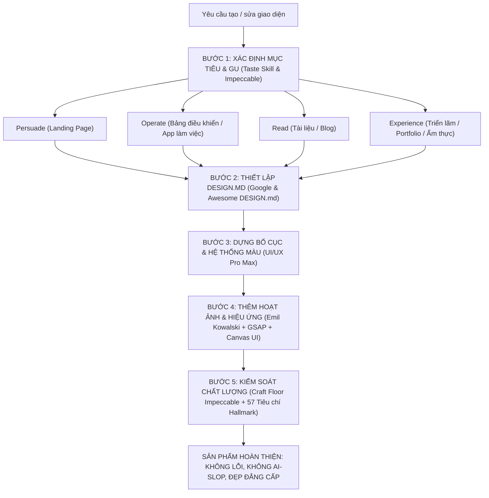

# TỔNG QUAN HỆ THỐNG KỸ NĂNG THIẾT KẾ GIAO DIỆN CHUYÊN NGHIỆP (UI/UX DESIGN SYSTEM)
> **Được chắt lọc và đồng bộ từ 12 GitHub Repositories hàng đầu thế giới dành cho AI Coding Agents (Claude Code, Antigravity, Codex)**

---

## 🗺️ Bản Đồ Phân Loại 12 Kho Vũ Khí Thiết Kế

| STT | Kho Vũ Khí (Repository) | Vai Trò Chính | Trọng Tâm Áp Dụng |
| :--- | :--- | :--- | :--- |
| 1 | **UI/UX Pro Max Skill** | Thiết kế UI/UX toàn diện | 192 quy tắc suy luận, 79 phong cách giao diện, tư duy bố cục theo ngành nghề |
| 2 | **Google DESIGN.md** | Định dạng đặc tả thiết kế | Tiêu chuẩn viết DESIGN.md bằng Prose + Tokens, định hình linh hồn sản phẩm |
| 3 | **Awesome DESIGN.md** | Thư viện mẫu thiết kế | Bộ sưu tập mẫu DESIGN.md thực tế cho đa dạng thể loại ứng dụng và website |
| 4 | **Impeccable** | Bộ tiêu chuẩn "Diệt Trừ AI Slop" | 24 câu lệnh và 61 quy tắc sàn chất lượng (Craft Floor), diệt sạch giao diện rập khuôn |
| 5 | **Hallmark** | Nghiệm thu 57 tiêu chí chất lượng | Bộ 57 tiêu chuẩn khắt khe đảm bảo UI như tác phẩm bảo tàng, không rườm rà |
| 6 | **Taste Skill** | Định hướng gu thẩm mỹ | 20 phong cách visual đã qua kiểm chứng (Awwwards/One Page Love), thẩm mỹ tinh gọn |
| 7 | **Skills for Designers & Engineers (Emil Kowalski)** | Hoạt ảnh vi mô & Vật lý chuyển động | Triết lý motion của kỹ sư Vercel/Linear: Spring physics, GPU transforms, không scale(0) |
| 8 | **GSAP Skills** | Hoạt họa nâng cao & Cuộn trang | Thư viện chuyển động GSAP Core, Timeline, ScrollTrigger mượt mà đa nền tảng |
| 9 | **React Bits** | Thư viện 200+ hiệu ứng React | Bộ sưu tập linh kiện giao diện có animation, text effects, backgrounds, visual components |
| 10 | **Canvas UI** | WebGL Shaders trên HTML DOM | Hiệu ứng chất lỏng, kính mờ, khúc xạ chạy trên nền WebGL mà chữ và nút vẫn bấm chọn được |
| 11 | **Scroll World** | 3D Seamless Scroll Landing Page | Kỹ thuật cuộn trang 3D mượt mà bay xuyên qua các chiều không gian |
| 12 | **Open Design** | Không gian thiết kế cục bộ | Môi trường nguyên mẫu nhanh, thiết kế slide, audit giao diện và hệ thống mẫu |

---

## 🏗️ Cấu Trúc Thư Mục Trong Dự Án

```
design-skills/
├── README.md                                  # Bản chỉ dẫn tra cứu tổng quan (file này)
├── 01-DESIGN-SYSTEMS-AND-SPEC.md              # Tiêu chuẩn viết DESIGN.md (Google + Awesome)
├── 02-UI-UX-PRO-MAX-GUIDE.md                  # 192 Quy tắc & 79 phong cách từ UI/UX Pro Max
├── 03-IMPECCABLE-61-RULES.md                  # 24 Lệnh & 61 Quy tắc Craft Floor từ Impeccable
├── 04-HALLMARK-57-QUALITY-CRITERIA.md         # 57 Tiêu chí nghiệm thu đỉnh cao từ Hallmark
├── 05-AESTHETIC-TASTE-DIRECTION.md            # Gu thẩm mỹ & định hướng visual từ Taste Skill
├── 06-MICRO-INTERACTIONS-AND-PHYSICS.md       # Hoạt ảnh vi mô & vật lý từ Emil Kowalski
├── 07-GSAP-AND-SCROLL-MOTION.md               # Kỹ thuật GSAP Timeline & ScrollTrigger
├── 08-CANVAS-WEBGL-AND-3D.md                  # WebGL tương tác (Canvas UI) & Cuộn 3D (Scroll World)
├── 09-REACT-BITS-COMPONENTS-CATALOG.md        # Danh mục 200+ components hoạt họa React Bits
└── sources/                                   # Toàn bộ mã nguồn gốc của 12 repository
    ├── awesome-design-md/
    ├── canvas-ui/
    ├── google-design-md/
    ├── gsap-skills/
    ├── hallmark/
    ├── impeccable/
    ├── open-design/
    ├── react-bits/
    ├── scroll-world/
    ├── skills-emil/
    ├── taste-skill/
    └── ui-ux-pro-max-skill/
```

---

## ⚡ Ma Trận Phối Hợp Khi Tạo Giao Diện Mới

Khi nhận yêu cầu tạo hoặc nâng cấp giao diện từ người dùng:



---

## 🎯 Cách Ra Lệnh Cho AI Để Tạo Giao Diện Đúng Ý

Bạn có thể yêu cầu AI thiết kế theo các phong cách hoặc áp dụng trực tiếp các bộ tiêu chuẩn:
1. **Thiết kế tổng thể theo thể loại**:
   * *"Thiết kế trang này theo phong cách Japanese Kissaten hoài cổ bằng chuẩn DESIGN.md"*
   * *"Tạo dashboard quản lý nhà hàng theo phong cách Swiss Minimalist của UI/UX Pro Max"*
2. **Kiểm tra và nâng tầm thẩm mỹ**:
   * *"Áp dụng 61 quy tắc Impeccable để diệt các thành phần rập khuôn AI trên trang này"*
   * *"Kiểm thử giao diện theo 57 tiêu chí của Hallmark xem có đạt chuẩn bảo tàng không"*
3. **Thêm hiệu ứng và chuyển động đỉnh cao**:
   * *"Thêm micro-interactions cho các nút bấm và card món ăn theo triết lý Emil Kowalski"*
   * *"Tạo hiệu ứng cuộn mượt mà với GSAP ScrollTrigger"*
   * *"Thêm hiệu ứng nền kính mờ khúc xạ WebGL bằng Canvas UI"*
