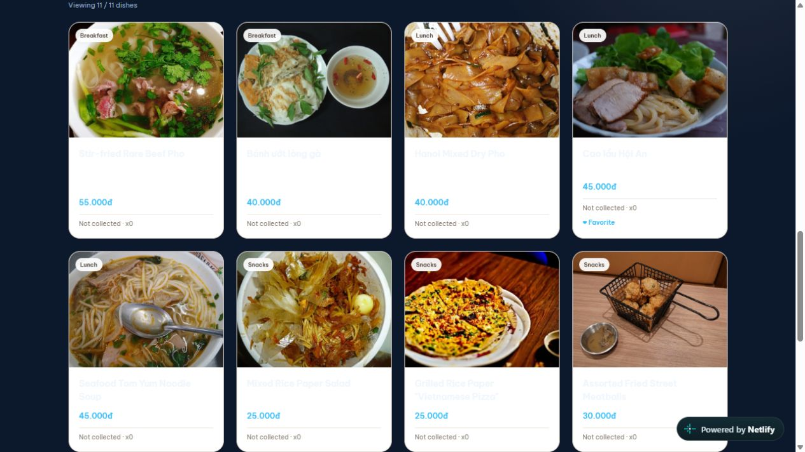

# Kiểm thử menu BFSC — 2026-10-29

URL: https://bfsc.netlify.app/  
Cách thử: mở tab IAB riêng, thao tác qua giao diện trình duyệt.

## Kết quả

- **Tìm kiếm:** nhập phở cho 11 kết quả. Trong đó có Phở tái lăn và Phở trộn, nhưng cũng có Cao lầu Hội An, Bánh tráng trộn/nướng và đồ uống. Đã mở chi tiết Cao lầu; phần mô tả đang hiển thị không có từ phở.
  - **Nghi vấn, chưa xác nhận:** relevance tìm kiếm có vẻ rộng. Có thể chủ đích dò tags/từ khóa ẩn; cần xác nhận tiêu chí tìm kiếm hoặc dữ liệu từ khóa trước khi kết luận bug.
- **Chi tiết món:** mở thẻ Cao lầu thành công; modal có ảnh, danh mục, giá, mô tả, nguồn ảnh, liên kết tìm quán Google Maps, cùng thao tác Yêu thích / Đánh dấu đã ăn / Không thích · Ẩn món.
- **Yêu thích:** bật Yêu thích trong modal thành công; sau khi đóng, thẻ hiển thị ♥ Favorite.
- **Danh sách cá nhân / bộ sưu tập:** giao diện có bộ chọn Danh sách của tôi và tiến độ 0 / 113 món. Trong lúc thử có thay đổi trạng thái lưu/bộ sưu tập trên profile IAB dùng chung; do các tester khác có thể cập nhật cùng localStorage, không quy kết thay đổi này cho thao tác ở tab.
- **Bộ lọc:** giao diện hiển thị All, Breakfast, Lunch, Afternoon, Dinner, Snacks, Drinks & Beverages. Thử chọn Lunch nhưng trạng thái quan sát lại vẫn là All và danh sách 12 món buổi sáng.
  - **Nghi vấn, chưa xác nhận:** bộ lọc không đổi kết quả trong lần thử; đồng thời có cập nhật đồng thời từ tab/agent khác, nên chưa đủ cơ sở phân biệt lỗi UI với ghi đè trạng thái.
- **Xem thêm:** sau khi bấm Xem thêm món, trạng thái vẫn 12 / 113 và nút còn hiện.
  - **Nghi vấn, chưa xác nhận:** lần bấm chưa làm tăng số món; cần thử lại trong tab/profile không bị thao tác đồng thời.
- **Nhiễu do thao tác đồng thời:** trong quá trình thử, ngôn ngữ, múi giờ, giao diện, ngân sách và nhạc nền đổi mà không chủ ý từ lượt này; theo điều phối, xem đây là interference giữa các agent, không ghi thành bug.
- **Quảng cáo:** không mở trang quảng cáo; chỉ thấy huy hiệu Netlify.

## Ảnh bằng chứng

